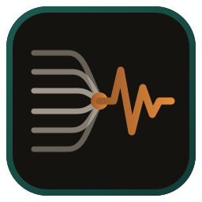
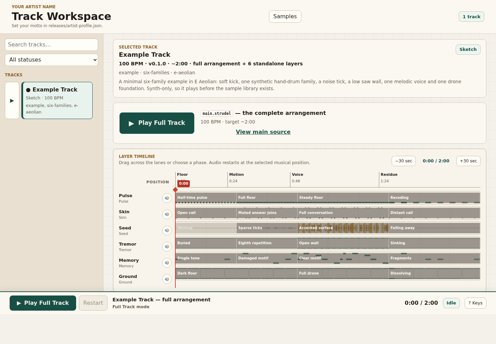
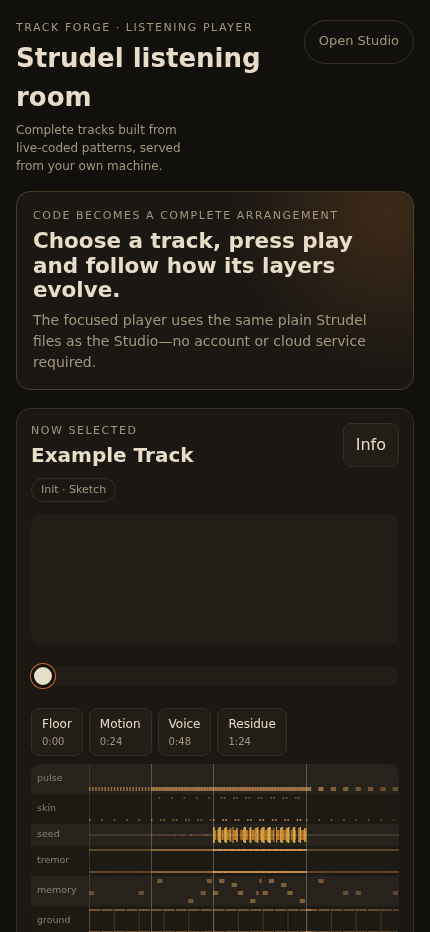
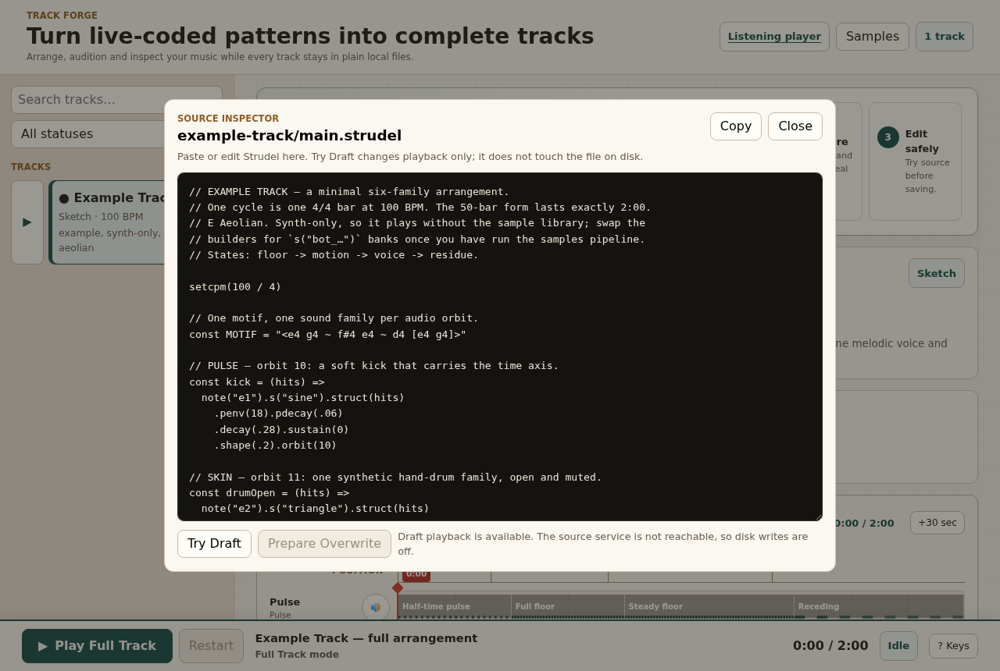

<p align="center">
  
</p>

<h1 align="center">Strudel Track Forge</h1>

<p align="center">
  <strong>Turn Strudel live-coding patterns into complete tracks you can see, audition and play on your phone.</strong>
</p>

<p align="center">
  A lightweight, self-hosted studio built around plain files—not accounts, a database or a cloud service.
</p>

<p align="center">
  <a href="#fastest-start">Fastest start</a> ·
  <a href="#what-you-get">What you get</a> ·
  <a href="docs/creating-a-track.md">Create a track</a>
</p>

<p align="center">
  <a href="https://github.com/RainerGewalt/strudel-track-forge/actions/workflows/ci.yml"></a>
  <a href="LICENSE"></a>
  <a href="https://nodejs.org/"></a>
</p>

<table>
  <tr>
    <td width="72%">
      
    </td>
    <td width="28%">
      
    </td>
  </tr>
  <tr>
    <td align="center"><strong>Build and understand the track</strong></td>
    <td align="center"><strong>Listen anywhere on your LAN</strong></td>
  </tr>
</table>

**In one sentence:** Strudel Track Forge is the bridge between a folder of
[Strudel](https://strudel.cc/) patterns and a complete track you can understand,
edit safely and listen to anywhere on your local network.

It adds the parts that become useful when a pattern grows into a full piece:
reliable transport, source auditioning, real arrangement lanes, track metadata
and a focused listening view.

No account. No database. No cloud service. Your music stays in your folders.

It is for Strudel musicians who want to move beyond a looping pattern without
hiding their work inside a traditional DAW project. It is not a hosted music
service, mastering suite or replacement for Strudel itself.

## What you get

<table>
  <tr>
    <td width="33%" valign="top">
      <strong>See the actual arrangement</strong><br /><br />
      Track Forge evaluates the patterns and draws their note or sample events.
      The timeline is analysis, not decorative artwork.
    </td>
    <td width="33%" valign="top">
      <strong>Change music without losing the original</strong><br /><br />
      Edit a source, run <em>Try Draft</em>, and only prepare a file overwrite after
      that exact version has played successfully.
    </td>
    <td width="33%" valign="top">
      <strong>Take the listening room with you</strong><br /><br />
      Serve a clean HTTPS player to phones and tablets on your local network,
      with phases, metadata and a live spectrum.
    </td>
  </tr>
</table>

And underneath it stays practical:

- one folder per track; plain `.strudel`, `.js` and `.json` files;
- one-click playback, hard stop/restart and live per-layer mutes;
- automatic track discovery — no central registry to maintain;
- a CC0 sample pipeline with checksums, evidence and a manual-review queue;
- explicit `soundPalette`, AI guardrails and rights-review fields per track.

> **Safe public demo:** this repository contains exactly one neutral, synth-only
> `example-track`. Its composition and arrangement are CC0. No private artist
> tracks, artwork or release metadata are included.

## Fastest start

You need Git, Node.js 20 or newer and npm.

```sh
git clone https://github.com/RainerGewalt/strudel-track-forge.git
cd strudel-track-forge
./setup.sh --dev --no-samples
```

Then open:

- **Studio:** [http://127.0.0.1:5173/](http://127.0.0.1:5173/)
- **Player:** [http://127.0.0.1:5173/player.html](http://127.0.0.1:5173/player.html)

The included two-minute demo uses browser synths, so it plays immediately — no
sample download or setup decisions required.

Try these three things first:

1. Click **Play Full Track**.
2. Mute a lane with its speaker button and drag the red position marker.
3. Open **View main source**, change a value, then click **Try Draft**.

## Hear an edit before it touches disk



The Source Inspector separates experimentation from saving:

1. **Try Draft** plays the editor contents only in the current browser session.
2. A successful trial unlocks **Prepare Overwrite**.
3. **Confirm Overwrite** saves only that exact tested revision.

If the file changed elsewhere, the source service refuses the stale write. In
local dev mode you can audition drafts; permanent browser writes are enabled
only when the optional source service and editor token are configured.

## Add your first track

```sh
npm run piece:create -- night-signal "Night Signal"
```

```text
src/pieces/night-signal/
├── main.strudel   # complete playable arrangement
├── notes.md       # intent and open questions
├── piece.js       # source imports exposed to the app
└── piece.json     # metadata, timeline, rights and creative guardrails
```

Tracks are discovered automatically. Use the included
[`example-track`](src/pieces/example-track/) as a readable reference, then follow
the short [track creation guide](docs/creating-a-track.md).

After changing `main.strudel`:

```sh
npm run timeline:previews
npm run pieces:validate
npm test
npm run build
```

## Put the player on your local network

With Docker Compose and OpenSSL installed, run:

```sh
./setup.sh
```

The guided setup builds the curated CC0 sample library (about 80 MB), timeline
previews, app and local TLS certificate, then starts nginx.

| Open | Purpose |
| --- | --- |
| `https://<lan-ip>/` | Focused mobile player |
| `https://<lan-ip>/index.html` | Full Studio |
| `http://<lan-ip>/local-ca.crt` | Local CA to install once on another device |

HTTPS is necessary for browser audio worklets outside `localhost`. Keep the
generated private CA key on the host machine and use the source service only on
a trusted network.

## Make it yours

Edit [`releases/artist-profile.json`](releases/artist-profile.json):

- `projectLabel` — the small label above the mobile player;
- `artistName` and `motto` — the main visible identity;
- `shortBio`, `longBio` and `profileImage` — optional listening context.

Placeholder values intentionally claim no artist identity or rights. Add track
artwork under `public/images/tracks/`, then run `npm run images:manifest`.

<details>
<summary><strong>Common commands</strong></summary>

| Command | Purpose |
| --- | --- |
| `npm run dev` | Start the local Vite Studio |
| `npm run piece:create -- <id> "<title>"` | Scaffold a track |
| `npm run pieces:validate` | Validate metadata and file integrity |
| `npm run timeline:previews` | Generate arrangement-lane data from real patterns |
| `npm run images:manifest` | Refresh artwork discovered by filename |
| `npm run samples:seed` | Seed the pinned VCSL source |
| `npm run samples:discover` | Find candidates from supported providers |
| `npm run samples:download` | Download only provider-verified CC0 candidates |
| `npm run samples:curate` | Normalize the approved selection |
| `npm run samples:build` | Build the local Strudel sample bank |
| `npm run samples:audit` | Verify provenance and checksums |
| `npm run player:start` / `npm run player:stop` | Start or stop the LAN player |

</details>

<details>
<summary><strong>Permanent source writes</strong></summary>

Copy `.env.example` to `.env`, generate a token with
`openssl rand -hex 24`, set `SOURCE_EDITOR_TOKEN`, and restart the Docker stack.
The browser stores a successfully used token only for the current tab. Never
commit `.env` or expose the source service to an untrusted network.

</details>

## Licensing and privacy

- **Application code:** [MIT](LICENSE).
- **Included Example Track:** [CC0 1.0](src/pieces/example-track/LICENSE.md).
- **Downloaded samples:** provider terms and provenance remain attached; the
  automatic path accepts only provider-confirmed CC0. See the
  [sample library documentation](sample-library/README.md).
- **Your tracks:** keep whatever terms you choose. Track Forge does not publish
  them or infer ownership.

Rights fields document what is known; they are not legal certification. Unknown
ownership, AI terms or sample permissions should stay explicitly unknown.

Track Forge deliberately stops short of becoming a DAW, mastering suite,
distributor integration or hosted collaboration platform. It is the focused
bridge between Strudel source files and a track you can understand, audition
and listen to anywhere at home.

AI editing rules live in [`AGENTS.md`](AGENTS.md) and [`agents/`](agents/).
